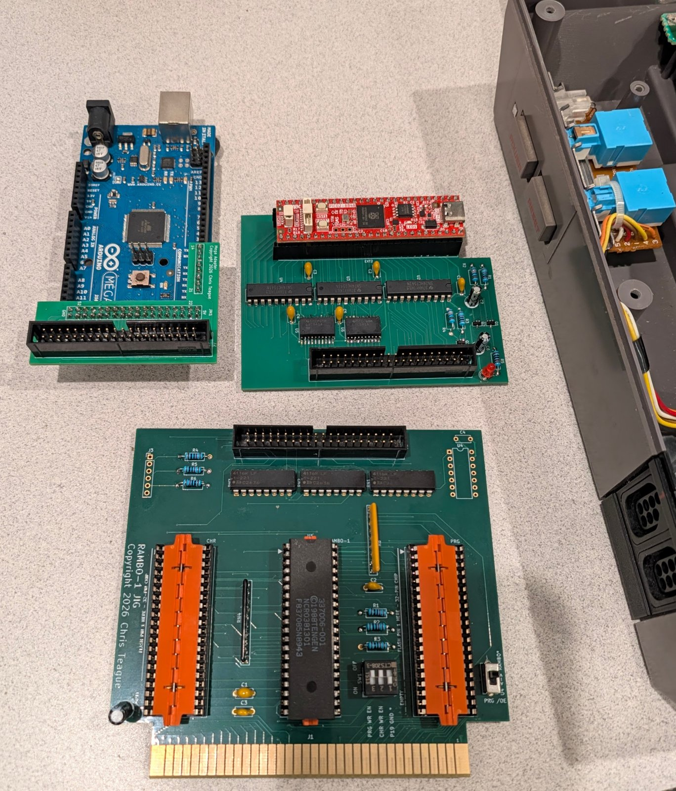
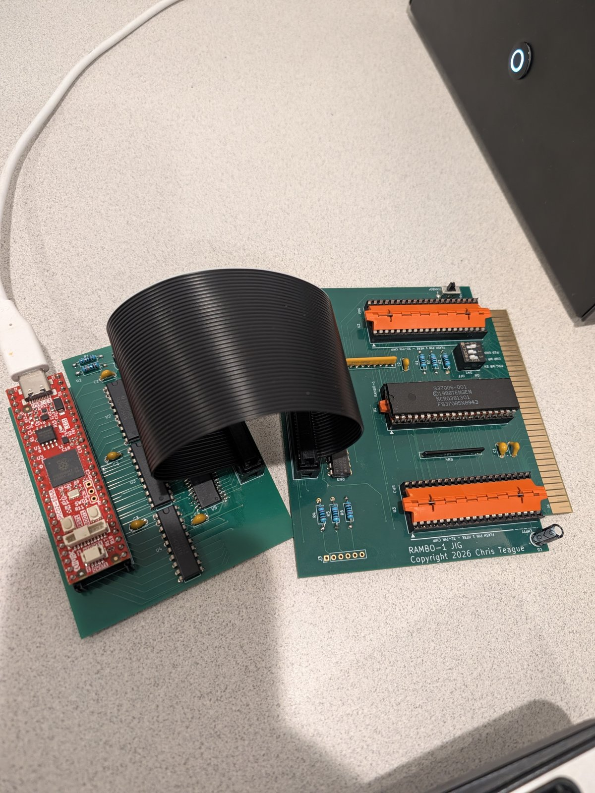
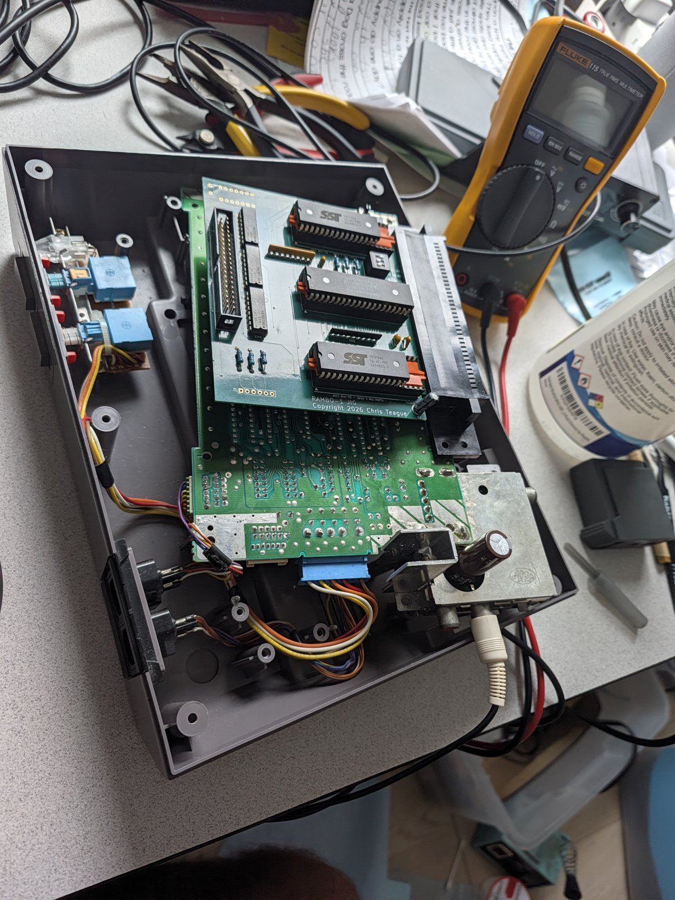
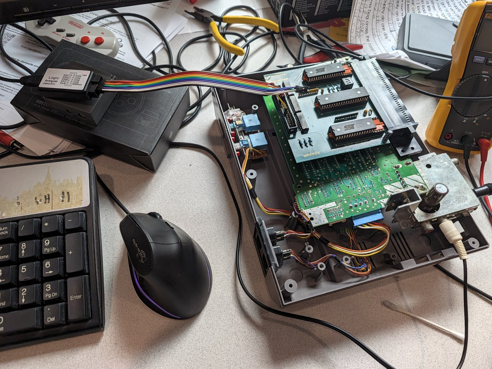

# Tengen RAMBO-1 (337006, iNES mapper 64): reverse engineering

A measured description of the Tengen RAMBO-1 mapper chip. It was characterised on a jig (Arduino Mega, later an RP2350
adapter with a PIO engine at 150 MHz), with a logic analyser on a running console, and checked with test ROMs on a real NES.
Every claim in the documents carries an evidence marker.

**Audience:** Software emulator authors, FPGA and cartridge designers.

## Where to start

| If you want to | Read |
|---|---|
| Check a claim | [`docs/findings.md`](docs/findings.md): F-001 to F-090, each with the experiment behind it. This is the heart of the research and everything else is derived from it. |
| Write or fix a mapper 64 emulator | [`docs/emulator_guide.md`](docs/emulator_guide.md). Section 4A is for people who already have an MMC3. For hardware-verified test ROMs, see [`rom/README.md`](rom/README.md) |
| Pins, timing figures and an HDL starting point | [`docs/fpga_notes.md`](docs/fpga_notes.md) |
| Understand how it works | [`docs/functional_description.md`](docs/functional_description.md) |
| Rebuild it in an FPGA or design a cartridge | [`docs/fpga_notes.md`](docs/fpga_notes.md), [`docs/timing_measurements.md`](docs/timing_measurements.md) |
| See what differs from NESdev Wiki | [`docs/nesdev_verification.md`](docs/nesdev_verification.md) |

## What is in the repository

| Path | Contents |
|---|---|
| `docs/` | The documents above, pin maps (`j2_*.csv`), the cart netlist, the logic-analyser guide, the RP2350 adapter plan and bring-up notes |
| `reference/` | `rambo1.py`, a small executable model of the chip (about 200 lines, every rule commented with its finding number), and its unit tests (`test_rambo1.py`) |
| `rom/` | Six test ROMs (G1 to G6, 62 tests) in ca65 assembly. They print PASS or FAIL and run on a real NES. `rom/tools/hwsim.py` runs them on a software model of the chip, and `rom/tools/run_checks.sh` runs everything |
| `firmware/rambo_jig/` | Arduino Mega 2560 firmware for the first jig |
| `firmware/rp2350_jig/` | RP2350 adapter firmware (PIO engine) and the host tools for experiments E2 to E10 |
| `hardware/` | KiCad projects, gerbers and BOMs for the jig board and the two adapters, with a README and the netlist generator |
| `tools/`, `experiments/` | Analysis scripts and experiment definitions for the Mega jig and the logic-analyser captures |
| `captures/`, `results/` | The raw evidence: sigrok captures and CSV logs |
| `pin_check/` | The continuity check of the pinout |

## Headline results

- The chip decodes registers on CPU A0, A13 and A14 only. It has R8, R9 and RF, a 1 KB CHR mode (K), and a CPU-cycle IRQ mode that the MMC3 does not have.
- The power-on state is defined: /IRQ asserted, PRG banks `$1F`, CHR bank 0 in 1 KB mode, latch `$FF`, vertical mirroring, and the counter already running in CPU-cycle mode (F-088).
- The A12 filter needs 16 consecutive M2 falls with A12 low. It samples A12 at the M2 fall only (F-081, F-084).
- The write window closes at the first of the M2 fall, the /ROMSEL rise and the R/W rise, and the data is latched at that instant (F-082).
- CHR bank registers and `$A000` are transparent during the window. R6, R7 and RF are not (F-089).
- The IRQ enable flag is tested at the M2 fall (F-071, F-072, F-074, F-090).
- An A12 to CPU mode switch while the filter is not full expires 4 cycles early (F-087). Test ROM G4 test 13 confirms it on the console.

## The hardware

<table>
<tr>
<td align="center"> The three boards: Arduino Mega with its adapter (left), RP2350 adapter (top right) and the RAMBO-1 jig / flash cart (bottom).</td>
<td align="center"> The RP2350 adapter connected to the jig board by the 40-way ribbon (J2).</td>
</tr>
<tr>
<td align="center"> The jig board with two flash chips, used as a flash cart in an NES: the test ROMs ran from here.</td>
<td align="center"> The same cart with the 8-channel logic analyser listening on the J2 header.</td>
</tr>
</table>

## Status and limits

- Everything was measured on **one chip** in one NTSC console. Differences between chip revisions or PAL consoles are unknown.
- Unresolved: the origin of the power-on /IRQ (F-034), the open-drain release time (F-080), the CIC, and pin 19's purpose beyond what F-046 and F-047 show.
- All six test ROMs pass on the real cart (62 tests).

## Building and running

All commands run in a Docker container through `./drun.sh`.
The first call builds the image: cc65 2.19, Python 3, sigrok-cli, SKiDL, CMake, the Pico SDK 2.3.1 and the Arm toolchain.

`./drun.sh --device /dev/ttyACM0 ...` passes the RP2350 adapter's serial port through.

The image does not include KiCad or the Arduino IDE.
Without Docker, install the same tools yourself (see the `Dockerfile`) and drop the `./drun.sh`.

- **Test ROMs:** `./drun.sh "cd rom && make"`

The ready-made images are in `rom/build/` (the six `g*.nes` files).
  Expected MD5 of the six test ROMs (`rom/build/g*.nes`, 524,304 bytes each):

  | Image | Tests | MD5 |
  |---|---|---|
  | `g1_power_on.nes` | Power-on state (after a power cycle only) | `1a89a4dbddda0af36ee58ceca1df30f4` |
  | `g2_banking.nes` | PRG/CHR banking, K/P/C bits, R8/R9, mirroring | `760dfb3409ce149c3a1709a5ff7fed32` |
  | `g3_bus.nes` | Register decode, /CE, bus conflicts, reads | `fb8c870fffdd3aa76c1b4d2a9c10f47f` |
  | `g4_cpu_irq.nes` | CPU-cycle IRQ mode and its timing races | `789a5981e2c5eeb491ff50dc27364bac` |
  | `g5_a12_irq.nes` | A12 (scanline) IRQ, filter, reload | `eef868d8110ecdc8c84e1b7ffd0370ba` |
  | `g6_raster.nes` | IRQ in real rendering, raster splits | `43c3a9863ed705edf7af60c8efafefa6` |

  Check with `./drun.sh "cd rom && md5sum build/g*.nes"`. A different cc65 version could change the bytes; the sums above were made with ca65 V2.18 - Ubuntu 2.19-1, which is what the image installs.
- **Checks without hardware:** `./drun.sh rom/tools/run_checks.sh`

builds the ROMs and runs them on the software models of the chip (the hardware model and the reference model).
- **Reference model:** `./drun.sh python3 -I reference/test_rambo1.py`.
- **RP2350 firmware:** `./drun.sh "cmake -S firmware/rp2350_jig -B firmware/rp2350_jig/build -G Ninja && cmake --build firmware/rp2350_jig/build"` gives `firmware/rp2350_jig/build/rp2350_jig.uf2`. (The container uses Ubuntu's Arm toolchain, so the bytes differ from the author's build.)
- **Netlist generator:** `./drun.sh "cd hardware/generators && python3 rambo1_cart.py"` (SKiDL warns about missing KiCad libraries).
- **Mega firmware:** open `firmware/rambo_jig/rambo_jig.ino` in the Arduino IDE.
- **Before connecting any jig or adapter to a cart, read the safety rules in [`hardware/README.md`](hardware/README.md#safety-read-before-building-the-jig).**

## Credits and licence

Chip identification and the register overview started from the NESdev wiki (mapper 64); Tengen's RAMBO-1 is a trademark of its owners.
The ONE emulator project provided cross-checks.
Licence: code, firmware and test ROM sources are MIT (`LICENSE`). Documents, measurements and captures are CC BY 4.0 (`LICENSE-docs.md`). Board designs are CERN-OHL-P-2.0 (`hardware/LICENSE-hardware.md`).
